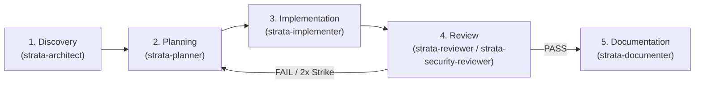

# Strata Agent Framework

**AI agents:** start with [AGENTS.md](AGENTS.md) for commands, project map and rules.

Version: `0.1.5` · License: [MIT](LICENSE)

Harness-agnostic framework for AI coding agents—3-ring progressive context, living blueprints, specialist subagents, and deterministic verification gates.

## Table of Contents

- [Why AI Coding Agents Drift—and How Strata Fixes It](#why-ai-coding-agents-driftand-how-strata-fixes-it)
- [How It Works: The Five Pillars](#how-it-works-the-five-pillars)
  - [1. Three Rings of Exposure & Mandatory Read Gates](#1-three-rings-of-exposure--mandatory-read-gates)
  - [2. Spec-Driven Development with Strata Blueprints](#2-spec-driven-development-with-strata-blueprints)
  - [3. The Single Evidence-Gated Development Loop](#3-the-single-evidence-gated-development-loop)
  - [4. Strict Role Separation & Unpoisoned Review Judging](#4-strict-role-separation--unpoisoned-review-judging)
  - [5. Disk Memory (`_internal/`) & Deterministic Scripts](#5-disk-memory-_internal--deterministic-scripts)
- [Supported Tools & Native Layouts](#supported-tools--native-layouts)
- [Install](#install)
- [Usage](#usage)
- [Core Documentation](#core-documentation)
- [High-Signal Skills](#high-signal-skills)
- [Quality Gate](#quality-gate)
- [Contributing](#contributing)
- [License](#license)

## Why AI Coding Agents Drift—and How Strata Fixes It

Strata was born out of two real-world frustrations:
1. **The local-model harness gap:** Commercial cloud harnesses (Claude Code, Kiro, Antigravity) rely on thousands of words of proprietary system-prompt engineering under the hood. When you point a lighter open harness (`pi.dev`, `opencode`, `qwen-code`, `codex`) at a local or self-hosted model, it lacks that foundational guidance—dumping massive walls of unreadable text, hallucinating tool flags, or wandering into unrequested refactors.
2. **The plan-drift & self-grading problem (even on frontier cloud models):** Even top-tier cloud models drift from the plan during long sessions. Left in a single context window, an agent will guess unstated requirements, over-engineer speculative abstractions, weaken a failing test assertion to get green, and slam the human with a 200-line victory lap that hides what was actually skipped.

Whether you are running a local model on your own hardware or switching between Kiro, Claude Code, Qwen Code, Antigravity, Gemini CLI, and Pi, the same failure modes appear as a project grows:

- **Walls of text & scope inflation:** Without strict response-length calibration and `YAGNI` boundaries, agents bury the human in filler and build features nobody asked for.
- **Attention dilution:** Once always-on instructions pass ~3,000–4,000 tokens, models start selectively dropping constraints.
- **Unpinned specs:** What looks like a coding bug is almost always an unstated requirement the agent guessed silently.
- **Self-graded homework:** An agent tasked with both writing and verifying code will happily pass unit tests with convoluted logic—or edit an existing test just to get a green check.
- **Stateless amnesia:** When architectural decisions, plans, and lessons live in chat history, every context reset or harness switch wipes the slate clean.

**You cannot prompt-engineer your way out of statelessness, self-grading bias, and attention dilution. Strata pairs frontier-grade foundational harness guidance with artifact and constraint engineering:**

1. **Bring frontier-grade foundational discipline to every harness:** Provide turn classification, parallel tool batching, zero-fluff human-readable replies (`Done D1 / Checked C1 / Not done N1`), and native per-app subagent tool schemas (`agents/{kiro,pi,claude,qwen,opencode}`) so local and cloud models alike stay sharp and concise.
2. **Keep always-on context razor-thin (~4k tokens)** and gate deep methodology behind **Mandatory Read Gates** that load only when entering a workflow stage.
3. **Pin intent in a living 3-layer blueprint** ([Strata Blueprints](https://stratablueprints.com)) before writing code—agents never guess an unstated requirement (`Not supplied:`), and a deterministic impact linter traces every spec change down to the exact rules it reopens.
4. **Enforce independent fresh-context judging:** Separate the blueprint architect (`strata-architect`), the planner (`strata-planner`), the builder (`strata-implementer`), and the verifier (`strata-reviewer`, `strata-security-reviewer`) into isolated specialist subagents with hard write boundaries, presume-wrong test auditing, and dead-switch grepping.
5. **Move state out of chat and onto disk (`_internal/`)** while shifting every countable, repeatable check out of model tokens and into zero-dependency Node.js (`.mjs`) verification scripts (`verify-plan.mjs`, `test-diff.mjs`, `audit.mjs`, `gate.mjs`).

---

## How It Works: The Five Pillars

### 1. Three Rings of Exposure & Mandatory Read Gates

Models treat passive `"see docs/foo.md"` links as optional suggestions, yet stuffing every procedure into always-on steering bloats context and degrades compliance (`A1`, `A6`). Strata organizes guidance into three concentric rings so agents pay only for the context a task requires:

| Ring | Location | Exposure | Role |
|------|----------|----------|------|
| **Ring 1: Always-On Posture** | [`AGENTS.md`](AGENTS.md) & [`steering/*.md`](steering/) | **100% (Every turn, ~2k–4.1k tokens)** | Non-negotiable behavioral invariants, safety boundaries, and **Mandatory Read Gates** into Ring 3. |
| **Ring 2: Triggered Entry Points** | [`agents/*.md`](agents/) & [`skills/*/SKILL.md`](skills/) | **Descriptions at startup; body on demand** | 8 specialist subagent contracts and 6 consolidated, self-contained high-signal skills (`A5`). |
| **Ring 3: Self-Contained Skill Docs & Scripts** | [`skills/*/references/`](skills/), [`assets/`](skills/), & [`scripts/*.mjs`](skills/) | **0% until read or executed** | Authoritative lifecycle methodology, domain engineering checklists, starter templates, and deterministic `.mjs` scripts bundled inside each owning skill. |

### 2. Spec-Driven Development with Strata Blueprints

A stale specification is worse than no specification (`A3`). Strata embeds **[Strata Blueprints](https://stratablueprints.com)** ([`skills/strata-blueprints/`](skills/strata-blueprints/SKILL.md), maintained upstream in [`TylerJPresley/strata-blueprints`](https://github.com/TylerJPresley/strata-blueprints)) as its core specification engine.

Every project's specification lives in `docs/blueprints/` across three zoom layers:
- **Layer 1: Vision (`sbp-vision.md`)** — Why the subject exists, target audience, Given/When/Then value scenarios (`vision-3.1`), success measures, and limits.
- **Layer 2: Structure (`sbp-structure.md`)** — How the system divides into parts, seams between parts, and scenario paths that realize Vision IDs.
- **Layer 3: Detail (`sbp-detail-<part>.md`)** — Rules, concepts/states, limits, and construction for a single part.

Unknowns are explicitly marked `Not supplied:`—agents are forbidden from guessing them and instead interview the Owner in structured discovery rounds. When any requirement changes, `strata-blueprints-lint.mjs --impact <id>` mechanically identifies every downstream path and rule that must be revisited.

### 3. The Single Evidence-Gated Development Loop

Planned work moves through five evidence-gated stages. Depending on the harness and task, you or your agent (e.g., Antigravity, Claude Code, Pi) can enter directly at **Stage 1 (Discovery)**—or connect through the situational **Orchestration & Triage** process (Pillar 4) when coordinating multi-part work or fast-path fixes ([`skills/strata-lifecycle/references/lifecycle.md`](skills/strata-lifecycle/references/lifecycle.md)):



- **Stage 1 (Discovery — `strata-architect`):** Interviews the Owner for product decisions, updates the blueprint, and runs `strata-blueprints-lint.mjs`.
- **Stage 2 (Planning — `strata-planner` + Pre-Build Red-Team):** Maps callers, second-order effects, and predicted file touches, then writes `_internal/plans/<slug>.md` and runnable acceptance criteria (`_internal/plans/<slug>.criteria`). **Every decision and edge case is pinned in the plan; the Implementer decides nothing.** For multi-seam or high-risk plans, `strata-reviewer` red-teams the plan in fresh context before coding starts to catch unpinned decisions, fakeable `.criteria`, or `YAGNI` bloat.
- **Stage 3 (Implementation — `strata-implementer`):** On `feature/<slug>`, executes vertical tracer-bullet TDD (`RED → GREEN → Mutate`) — writing the failing test first, building the code to pass, mutating production logic to prove the test catches regressions, and committing at each logical seam after `node gate.mjs` and `verify-plan.mjs` pass. If an approach fails twice (**Two-Strike Rule**), execution stops for re-planning.
- **Stage 4 (Review — `strata-reviewer` & `strata-security-reviewer` as the Independent Judge):** Global context is an asset in Stages `1–3` and poison at Stage 4. Whether Stages `1–3` ran directly in the main session or via subagents, Stage 4 spawns `strata-reviewer` in a fresh subagent context with a **blind-artifact brief** (only blueprint path, plan/criteria paths, and `git diff`—zero builder narrative). `strata-reviewer` runs (A) Mechanical & Spec/Criteria compliance (`verify-plan.mjs`, `gate.mjs`, `test-diff.mjs`, and `gate.mjs` loosening checks) followed by (B) Code Quality, presume-wrong test auditing, dead-switch call-site grepping, and **active adversarial fault-injection probes** in `_internal/scratch/`.
- **Stage 5 (Documentation — `strata-documenter`):** Updates `README.md`, `CHANGELOG.md`, `CONTRIBUTING.md`, and `docs/` to match what was built.

### 4. Strict Role Separation & Unpoisoned Review Judging

One global specialist roster ([`agents/`](agents/)) governs every project with strict write isolation ([`skills/strata-lifecycle/references/roles-and-standing-rules.md`](skills/strata-lifecycle/references/roles-and-standing-rules.md)). **`strata-reviewer` + the deterministic `.mjs` scripts ARE the judge:** the builder or orchestrator never edits `<slug>.review.md` and cannot unilaterally dismiss a `FAIL` finding (it must either fix the defect, pass a cold `file:line` citation back to `strata-reviewer` so *the reviewer* flips `<slug>.review.md` to `PASS`, or escalate a `CONFLICT` to the Owner after at most 3 rounds):

| Specialist | Role | Allowed Writes | Hard Denies |
|------------|------|----------------|-------------|
| [`strata-director`](agents/prompts/strata-director.md) | Team lead & router | `_internal/handoff.md`, `decisions.md`, `lessons.md`, `plans/archive/**` | Source code, tests, blueprints, repo docs |
| [`strata-architect`](agents/prompts/strata-architect.md) | Blueprint architect | `**/sbp-*.md`, `**/*blueprint*.md`, `**/questions.md` | Never guesses `Not supplied:`, no code/tests/plans |
| [`strata-planner`](agents/prompts/strata-planner.md) | Systems designer | `_internal/plans/<slug>.md`, `<slug>.criteria`, `proposals/**` | No shell execution, no code/test/doc edits |
| [`strata-implementer`](agents/prompts/strata-implementer.md) | Test-first builder | Source code, tests, `gate.mjs`, commits on `feature/<slug>` | Blueprints, `AGENTS.md`, `README.md`, `*.review.md` |
| [`strata-reviewer`](agents/prompts/strata-reviewer.md) | Independent verifier | `_internal/plans/<slug>.review.md`, `_internal/scratch/**` | Read-only on source, tests, blueprints, plans, docs |
| [`strata-security-reviewer`](agents/prompts/strata-security-reviewer.md) | Supply-chain & security auditor | `_internal/plans/<slug>.security.md`, `_internal/scratch/audit/**` | Read-only on project files; judges `audit.mjs` hits |
| [`strata-researcher`](agents/prompts/strata-researcher.md) | Primary-source investigator | `_internal/research/**` (sources, findings, SHA-256 index) | Never edits code, specs, plans, or repo docs |
| [`strata-documenter`](agents/prompts/strata-documenter.md) | Documentation keeper | `README.md`, `CONTRIBUTING.md`, `CHANGELOG.md`, `docs/**` | Blueprints (`sbp-*.md`), source code, tests |

### 5. Disk Memory (`_internal/`) & Deterministic Scripts

Continuity lives on disk in `<project>/_internal/` (gitignored, never in chat or `/tmp`):
- **`handoff.md` (`progress.mjs` & `ctx.mjs`):** A `<6000`-character state checkpoint read automatically at session start and updated before context fullness crosses `30%`.
- **`lessons.md` (`lessons.mjs`):** Tracks recurring friction. When a pattern is recorded 3 times (`READY`), a retrospective promotes it into a deterministic script check first, a doc/skill second, and an always-on steering rule only as a last resort.
- **`research/` (`research-index.mjs`):** Durable cache of primary sources and cited findings verified by SHA-256 hash so future sessions never pay tokens to re-research the same API or library.
- **Zero-Dependency Verification Scripts ([`skills/strata-lifecycle/scripts/`](skills/strata-lifecycle/scripts/) & [`skills/strata-security-audit/scripts/`](skills/strata-security-audit/scripts/)):** Pure Node.js (`.mjs`) tools (`verify-plan.mjs`, `test-diff.mjs`, `audit.mjs`, `steering-lint.mjs`, `push.mjs`, `progress.mjs`, `lessons.mjs`, `research-index.mjs`, `ctx.mjs`) execute all mechanical checks with zero external `npm` packages.

---

## Supported Tools & Native Layouts

`node scripts/distribute.mjs` deploys directly into each selected tool's native directory in the exact format that tool expects, rewriting internal skill and script paths to that tool's own directory so every deployment is 100% self-contained:

| Target Name | Default Path | Ring 1 Conductor (Always-On) | Ring 2 Specialist Subagents (`agents/<app>/`) | Ring 2 & 3 Self-Contained Skills | Hooks |
|-------------|--------------|------------------------------|-----------------------------------------------|----------------------------------|-------|
| **`kiro`** | `~/.kiro` | `steering/strata-*.md` (18 atomic rules) | `agents/kiro/strata-*.json` → `~/.kiro/agents/strata-*.json` (8 agents with Kiro permissions) | `skills/strata-*/` (`SKILL.md`, `references/`, `assets/`, `scripts/`) | `hooks/strata-handoff-start.json` |
| **`pi`** | `~/.pi/agent` | `AGENTS.md` (managed `<!-- STRATA -->` bottom block) | `agents/pi/strata-*.md` → `~/.pi/agent/agents/strata-*.md` (7 specialists with Pi tools) | `skills/strata-*/` | — |
| **`claude`** | `~/.claude` | `CLAUDE.md` (managed `<!-- STRATA -->` bottom block) | `agents/claude/strata-*.md` → `~/.claude/agents/strata-*.md` (7 specialists with Claude tools) | `skills/strata-*/` | — |
| **`qwen`** | `~/.qwen` | `QWEN.md` (managed `<!-- STRATA -->` bottom block) | `agents/qwen/strata-*.md` → `~/.qwen/agents/strata-*.md` (7 specialists with Qwen tools) | `skills/strata-*/` | — |
| **`gemini`** | `~/.gemini` | `GEMINI.md` (managed `<!-- STRATA -->` bottom block) | — | `config/skills/strata-*/` | — |
| **`opencode`** | `~/.config/opencode` | `AGENTS.md` (managed `<!-- STRATA -->` bottom block) | `agents/opencode/strata-*.md` → `~/.config/opencode/agents/strata-*.md` (7 specialists) | `skills/strata-*/` | — |
| **`codex`** | `~/.codex` | `AGENTS.md` (managed `<!-- STRATA -->` bottom block) | — | `skills/strata-*/` | — |
| **`hermes`** | `~/.hermes` | `SOUL.md` (managed `<!-- STRATA -->` bottom block) | — (uses `delegate_task`) | `skills/strata-*/` | — |
| **`agents-global`** | `~/.agents` | `steering/strata-*.md` (optional shared store) | `agents/prompts/strata-*.md` | `skills/strata-*/` | `hooks/strata-handoff-start.json` |
| **Custom (`--add`)** | `<dir>[:<layout>]` | Inferred or specified layout (`pi`, `claude`, `qwen`, `kiro`, `gemini`, `codex`, `opencode`, `agents`) | Per layout | Per layout | Per layout |

- **Non-destructive root file registration:** For tools that use a single root instruction file (`AGENTS.md`, `CLAUDE.md`, `QWEN.md`, `GEMINI.md`, `SOUL.md`), `distribute.mjs` appends and updates a fenced `<!-- STRATA:START --> ... <!-- STRATA:END -->` block at the bottom of the file, preserving any custom rules or identity text above it. Unchecking the tool cleanly removes only that block.

---

## Install

Requires Node.js 20+ (Node.js 22+ recommended for blueprint linting) and Git.

Clone the repository and preview what will be deployed across your installed tools (`~/.kiro`, `~/.pi/agent`, `~/.claude`, `~/.gemini`, etc.):

```bash
git clone https://github.com/TylerJPresley/strata-agent-framework.git
cd strata-agent-framework
node scripts/distribute.mjs --dry-run
```

Run `node scripts/distribute.mjs` to open the **interactive target checklist**, showing every supported tool location (`~/.kiro`, `~/.pi/agent`, `~/.claude`, `~/.gemini`, `~/.hermes`, `~/.codex`, `~/.config/opencode`, `~/.agents`), its currently deployed version, and which files need updating:

```bash
# Interactive checklist (↑/↓ move, Space toggle, c add custom dir, Enter confirm)
node scripts/distribute.mjs

# Add a custom target or project directory (optionally specifying :pi, :claude, :gemini, :kiro, :codex, :opencode, or :agents layout)
node scripts/distribute.mjs --add ~/.config/voidrift

# Non-interactive deploy using your saved target selection (~/.agents/.strata-targets.json)
node scripts/distribute.mjs --yes
```

Unchecking a previously deployed harness (or passing `--remove ~/.config/voidrift`) automatically reads its `.strata-manifest.json` and cleanly uninstalls only the Strata-managed files while leaving your other configs, MCP servers, and runtime state untouched.

> [!NOTE]
> **Embedded `strata-blueprints` Skill (`v0.4.1`):** This repository ships with [`strata-blueprints`](skills/strata-blueprints/SKILL.md) `0.4.1` embedded out of the box. If you maintain a local checkout of the standalone [`strata-blueprints`](https://github.com/TylerJPresley/strata-blueprints) repository, `node scripts/distribute.mjs` automatically syncs from `../strata-blueprints/skills/strata-blueprints` (or `STRATA_BP_SOURCE`), or you can sync manually with:
> `node scripts/sync-skill.mjs <path-to-strata-blueprints>/skills/strata-blueprints --target ./skills`

## Usage

Once deployed, your AI harnesses automatically load Ring 1 (`AGENTS.md`, `CLAUDE.md`, `GEMINI.md`, or `steering/*.md`) and discover Ring 2 skills and subagents from `~/.agents`:

```bash
# Verify that all installed harnesses match the repository manifest and pass steering-lint
node scripts/distribute.mjs --check

# Inside any software project, run the project's quality gate
node gate.mjs

# Run a deterministic acceptance-criteria check for an active feature plan
node ~/.agents/skills/strata-lifecycle/scripts/verify-plan.mjs _internal/plans/<slug>.criteria

# Audit modified tests in a commit range against the plan's "## Existing tests changed"
node ~/.agents/skills/strata-lifecycle/scripts/test-diff.mjs

# Run a deterministic dependency, license, secret, and code-pattern audit
timeout 300 node ~/.agents/skills/strata-security-audit/scripts/audit.mjs

# Lint a Strata Blueprint directory or run an upstream change impact check
node ~/.agents/skills/strata-blueprints/scripts/strata-blueprints-lint.mjs docs/blueprints
node ~/.agents/skills/strata-blueprints/scripts/strata-blueprints-lint.mjs --impact vision-3.1 docs/blueprints
```

## Core Documentation

- **[`skills/strata-lifecycle/references/vision.md`](skills/strata-lifecycle/references/vision.md)** — The problem statement, the 7 Core Assertions (`A1`–`A7`), and the Rings of Exposure.
- **[`skills/strata-lifecycle/references/structure.md`](skills/strata-lifecycle/references/structure.md)** — Anatomy of `~/.agents`, required project repository files (`AGENTS.md`, `CONTRIBUTING.md`, `README.md`, `docs/blueprints/`, `gate.mjs`), `_internal/` working folder layout, and script reference table.
- **[`skills/strata-lifecycle/references/lifecycle.md`](skills/strata-lifecycle/references/lifecycle.md)** — The single development loop from Triage through Discovery, Planning, Implementation, Review, and Documentation.
- **[`skills/strata-lifecycle/references/roles-and-standing-rules.md`](skills/strata-lifecycle/references/roles-and-standing-rules.md)** — Specialist write scopes, the 7-Part Specialist Brief, universal standing rules, `CONFLICT` protocol, structured reply format (`D1/C1/A1/P1/N1`), context handoffs, research cache, and retrospective lesson promotion.
- **[`skills/strata-security-audit/references/security-and-audit.md`](skills/strata-security-audit/references/security-and-audit.md)** — Secure-by-default principles, 9-point security review checklist, and mechanical dependency/license/secret auditing via `skills/strata-security-audit/scripts/audit.mjs`.
- **[`skills/strata-lifecycle/references/engineering-craft.md`](skills/strata-lifecycle/references/engineering-craft.md)** — Domain engineering checklists (Requirements/EARS, Architecture, Backend/APIs, Data, Systems/CLI, Web/Frontend, Cloud Ops, Reliability/SRE, Product).
- **[`skills/strata-lifecycle/assets/`](skills/strata-lifecycle/assets/)** & **[`skills/strata-lifecycle/references/`](skills/strata-lifecycle/references/)** — Starter templates (`AGENTS.template.md`, `CONTRIBUTING.template.md`, `README.template.md`, `gate.template.mjs`, `plan-template.md`, `handoff-template.md`, `discovery-round-template.md`, `ears-gwt.md`) and reference tables.

## High-Signal Skills

To avoid skill-routing degradation (`A5`), global skills are consolidated into 6 distinct entry points:

1. **[`strata-blueprints`](skills/strata-blueprints/SKILL.md)** — Author, lint, condense, publish, and build from 3-layer Strata Blueprints (`Vision`, `Structure`, `Detail`).
2. **[`strata-lifecycle`](skills/strata-lifecycle/SKILL.md)** — Master router for project file bootstrap, triage, discovery, feature planning, test-first builds, independent review, and session handoffs.
3. **[`strata-security-audit`](skills/strata-security-audit/SKILL.md)** — Deterministic dependency, license, secret, and security review workflow (`skills/strata-security-audit/scripts/audit.mjs` + `skills/strata-security-audit/references/security-and-audit.md`).
4. **[`strata-diagnosing-bugs`](skills/strata-diagnosing-bugs/SKILL.md)** — Fast-feedback reproduction, root-cause hypothesis testing, and regression test verification.
5. **[`strata-optimization-loop`](skills/strata-optimization-loop/SKILL.md)** — Measure-change-verify loop for moving a single metric toward a target at minimum cost.
6. **[`strata-teach`](skills/strata-teach/SKILL.md)** — Long-term retention teaching workspace driven by primary sources and spaced retrieval practice.

## Quality Gate

Run the repository quality gate (steering/skill linter + 196 deterministic script unit tests in `tests/`) from the repo root:

```bash
node gate.mjs
```

## Contributing

See [CONTRIBUTING.md](CONTRIBUTING.md).

## License

MIT (see [LICENSE](LICENSE)).
